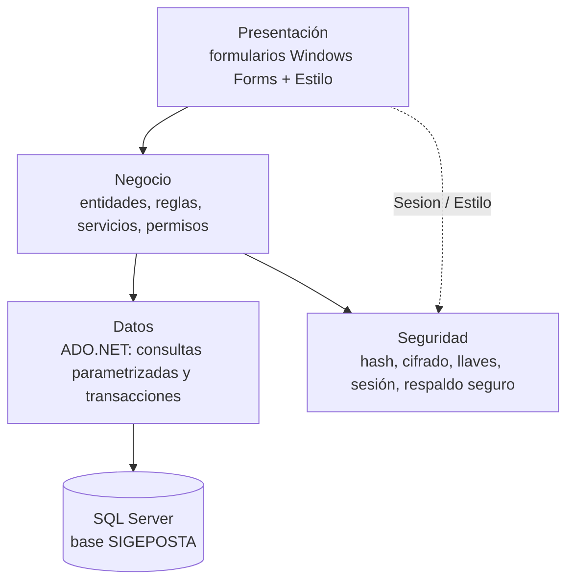
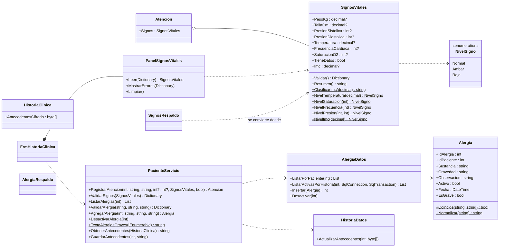

# Diagrama de clases — SIGEPOSTA

Sistema de gestión de postas de salud (Windows Forms, C#, .NET Framework 4.7.2).
El diagrama se generó leyendo el código real de la carpeta `SIGEPOSTA/` (proyecto `SIGEPOSTA.csproj`).
Solo aparecen los miembros principales de cada clase; los detalles menores (campos privados, manejadores de eventos) se omiten.

> **Cómo verlo:** pegue el bloque ```` ```mermaid ```` en <https://mermaid.live>, o ábralo en GitHub / VS Code con la extensión
> *Markdown Preview Mermaid Support* (requiere Mermaid 10.3 o superior por el uso de `namespace`).
> La misma información en formato PlantUML está en [`UML_Clases.puml`](UML_Clases.puml).

## Arquitectura en capas (resumen)



Regla de dependencia: la **Presentación** solo habla con los **servicios** de Negocio; los servicios usan las clases de **Datos** y de **Seguridad**;
solo **Datos** toca SQL Server. (Excepción documentada: `PacienteServicio` (registrar paciente y recetar) e `InventarioServicio` abren la `SqlConnection`/`SqlTransaction` para
hacer una operación atómica y se la pasan a las clases de Datos.)

## Diagrama de clases completo

```mermaid
classDiagram
direction TB

namespace Presentacion {
    class Estilo {
        <<static>>
        +Rojo : Color
        +Morado : Color
        +Dorado : Color
        +EspacioCampos : int
        +MargenInterior : int
        +AltoCampo : int
        +PrepararDialogo(Form, string)
        +CrearBarraTitulo(string) Panel
        +CrearRecuadro(string) GroupBox
        +CrearCampo(string, Control) TableLayoutPanel
        +CrearCampoConError(string, Control, Label) TableLayoutPanel
        +CrearBotonPrimario(string) Button
        +CrearBotonSecundario(string) Button
        +CrearBotonPeligro(string) Button
        +EstilizarGrid(DataGridView)
        +CrearBarraEstado(ToolStripStatusLabel) StatusStrip
        +MostrarConsulta(ToolStripStatusLabel, long)
        +CrearPaginador(...) TableLayoutPanel
        +PintarFilaAlerta(DataGridViewRow, Medicamento)
        +VincularEnter(Form, Control, IButtonControl)
        +EscCierra(Form)
        +MostrarError(IWin32Window, string)
        +MostrarExito(IWin32Window, string)
    }
    class FrmLogin {
        -BtnIngresar_Click()
    }
    class FrmCrearAdmin {
        -BtnCrear_Click()
    }
    class FrmPrincipal {
        +CerrarSesionSolicitado : bool
        +MotivoCierre : string
        -Abrir(Action, Func~Form~)
        -CerrarSesion(string)
        -CerrarPorInactividad()
    }
    class FrmPacientes {
        -RecargarLista()
        -Mostrar(ResultadoPagina)
        -BtnGuardar_Click()
        -BtnEliminar_Click()
        -AbrirHistoria()
    }
    class FrmHistoriaClinica {
        -RecargarAtenciones()
        -BtnGuardar_Click()
    }
    class FrmInventario {
        -Mostrar(ResultadoPagina)
        -PintarFila(DataGridViewRow, Medicamento)
        -BtnGuardar_Click()
        -BtnMovimiento_Click()
        -AbrirHistorial()
    }
    class FrmHistorialMovimientos
    class ItemCatalogo {
        +Id : int
        +Nombre : string
        +Activo : bool
        +MedicamentosQueLoUsan : int
        +EsSinDefinir : bool
    }
    class CatalogoServicio {
        +ListarActivos(TipoCatalogo) List~ItemCatalogo~
        +ContarMedicamentos(TipoCatalogo, int) int
        +Validar(string) Dictionary
        +Registrar(TipoCatalogo, string) ItemCatalogo
        +Actualizar(TipoCatalogo, int, string)
        +DarDeBaja(TipoCatalogo, int)
    }
    class CatalogoDatos {
        +Listar(TipoCatalogo) List~ItemCatalogo~
        +Obtener(TipoCatalogo, int) ItemCatalogo
        +ExisteNombre(TipoCatalogo, string, int) bool
        +Insertar(TipoCatalogo, string) int
        +ActualizarNombre(TipoCatalogo, int, string)
        +BajaLogica(TipoCatalogo, int)
        +ContarMedicamentos(TipoCatalogo, int) int
    }
    class FrmFormasUnidades {
        -AlCambiarCatalogo()
        -BtnGuardar_Click()
        -BtnEliminar_Click()
    }
    class Cie10 {
        +Codigo : string
        +Descripcion : string
        +Activo : bool
        +Texto : string
    }
    class Cie10Servicio {
        +BuscarPagina(string, int, Func) ResultadoPagina~Cie10~
        +Sugerir(string, Func) ResultadoPagina~Cie10~
        +Obtener(string) Cie10
        +Validar(string, string, bool) Dictionary
        +Registrar(string, string) Cie10
        +Actualizar(string, string)
        +DarDeBaja(string)
        +CifrarCodigo(string) byte[]
        +DescifrarCodigo(byte[], out bool) string
    }
    class Cie10Datos {
        +Contar(string) int
        +ListarPagina(string, int, int) List~Cie10~
        +Sugerir(string, int) List~Cie10~
        +ObtenerPorCodigo(string) Cie10
        +ListarTodos() List~Cie10~
        +Insertar(Cie10)
        +ActualizarDescripcion(string, string)
        +BajaLogica(string)
    }
    class FrmCie10 {
        -Mostrar(ResultadoPagina)
        -BtnGuardar_Click()
        -BtnEliminar_Click()
    }
    class CuadroCie10 {
        +CodigoElegido : string
        +HayTextoSinElegir : bool
        +Limpiar()
    }
    class DiagnosticoReporteFila {
        +Fecha : DateTime
        +Cie10Cifrado : byte[]
    }
    class Proveedor {
        +IdProveedor : int
        +Nombre : string
        +Ruc : string
        +Telefono : string
        +Correo : string
        +Direccion : string
        +Activo : bool
    }
    class ProveedorServicio {
        +BuscarPagina(string, int, Func) ResultadoPagina~Proveedor~
        +ListarActivos() List~Proveedor~
        +Validar(...) Dictionary
        +ListarFormasActivas() List~ItemCatalogo~
        +ListarUnidadesActivas() List~ItemCatalogo~
        +Registrar(nombre, concentracion, idForma, idUnidad, ...) Proveedor
        +Actualizar(...)
        +DarDeBaja(int)
        +ContarMovimientos(int) int
    }
    class ProveedorDatos {
        +Contar(string) int
        +ListarPagina(string, int, int) List~Proveedor~
        +ListarActivos() List~Proveedor~
        +ExisteRuc(string, int) bool
        +Insertar(Proveedor) int
        +Actualizar(Proveedor)
        +BajaLogica(int)
        +ExisteActivo(int, SqlConnection, SqlTransaction) bool
        +ContarMovimientos(int) int
    }
    class FrmProveedores {
        -Mostrar(ResultadoPagina)
        -BtnGuardar_Click()
        -BtnEliminar_Click()
    }
    class FrmUsuarios {
        -BtnGuardar_Click()
        -BtnEstado_Click()
    }
    class FrmRespaldo {
        -Worker_DoWork()
        -Worker_ProgressChanged()
        -Worker_Completed()
        -BtnRespaldar_Click()
        -BtnAbrir_Click()
    }
    class FrmReportes {
        -BtnGenerar_Click()
        -BtnExportar_Click()
    }
    class MonitorInactividad {
        <<sealed>>
        +LimitePorDefecto : TimeSpan
        +InactividadAgotada : event
        +Iniciar()
        +Pausar()$
        +Reanudar()$
        +PreFilterMessage(Message) bool
    }
    class PanelDashboard {
        -Construir()
        +Actualizar()
        -Worker_Completed()
        -Aplicar(DatosDashboard)
        -LlenarGrafico(...)
        -LlenarAlertas(...)
        +SolicitaInventario : event
    }
    class TarjetaKpi {
        +Mostrar(int, NivelKpi)
    }
    class NivelKpi {
        <<enumeration>>
        Normal
        Ambar
        Rojo
    }
    class ControladorBusqueda~T~ {
        <<sealed>>
        +EsperaMilisegundos : int
        +Filtro : object
        +TextoCambio(string)
        +BuscarYa()
        +IrAPagina(int)
        +Recargar()
    }
    class ManejadorErrores {
        <<static>>
        +Instalar()
        +Registrar(Exception) string
    }
}

namespace Negocio {
    class Persona {
        <<abstract>>
        +Dni : string
        +Nombres : string
        +Apellidos : string
        +FechaNacimiento : DateTime
        +Telefono : string
        +NombreCompleto : string
        +ObtenerEdad() int
        +MostrarDatos() string
    }
    class Paciente {
        +IdPaciente : int
        +IdPosta : int
        +Direccion : string
        +DniCifrado : byte[]
        +DniHash : string
        +IdHistoria : int
        +NumeroHistoria : string
        +MostrarDatos() string
    }
    class HistoriaClinica {
        +IdHistoria : int
        +IdPaciente : int
        +NumeroHistoria : string
        +Atenciones : IReadOnlyList~Atencion~
        +AgregarAtencion(Atencion)
    }
    class Atencion {
        +IdAtencion : int
        +IdHistoria : int
        +IdMedico : int
        +Fecha : DateTime
        +Motivo : string
        +Diagnostico : string
        +DiagnosticoCifrado : byte[]
        +Cie10Cifrado : byte[]
        +Cie10Codigo : string
        +Cie10Descripcion : string
        +Cie10Ilegible : bool
        +Cie10Texto : string
        +IdMedicamento : int
        +CantidadRecetada : int
        +RecetaTexto : string
        +TieneReceta : bool
    }
    class Establecimiento {
        <<static>>
        +Nombre : string
        +IdPosta : int
        +Inicializar()
    }
    class Posta {
        +IdPosta : int
        +Nombre : string
        +Distrito : string
        +Categoria : string
    }
    class Medicamento {
        +IdMedicamento : int
        +Nombre : string
        +Presentacion : string
        +Concentracion : string
        +IdForma : int?
        +IdUnidad : int?
        +FormaNombre : string
        +UnidadNombre : string
        +NombreCompleto : string
        +StockTexto : string
        +FormatoCantidad(int, string) string$
        +Stock : int
        +StockMinimo : int
        +FechaVencimiento : DateTime
        +EstaBajoStock : bool
        +EstaPorVencer : bool
        +EstaVencido : bool
        +DescripcionStock : string
        +Ingresar(int)
        +Retirar(int)
    }
    class MovimientoInventario {
        +IdMovimiento : int
        +Tipo : TipoMovimiento
        +Cantidad : int
        +Motivo : string
        +IdProveedor : int?
        +NumeroDocumento : string
        +NombreProveedor : string
        +Fecha : DateTime
    }
    class Usuario {
        +IdUsuario : int
        +NombreUsuario : string
        +PasswordHash : byte[]
        +Salt : byte[]
        +Iteraciones : int
        +Rol : Rol
        +Activo : bool
        +IntentosFallidos : int
        +BloqueadoHasta : DateTime
        +EstaBloqueado : bool
    }
    class Rol {
        <<enumeration>>
        Administrador
        Medico
        Farmacia
    }
    class TipoMovimiento {
        <<enumeration>>
        Ingreso
        Salida
    }
    class Validador {
        <<static internal>>
        +TextoObligatorio(string, string, int) string
        +Dni(string) string
        +Telefono(string) string
        +NoNegativo(int, string) int
        +Positivo(int, string) int
        +FechaNoFutura(DateTime, string) DateTime
    }
    class ValidacionException {
        +Campo : string
    }
    class ReglaNegocioException
    class AccesoDenegadoException
    class Permisos {
        <<static>>
        +PuedeAccederPacientes : bool
        +PuedeAccederInventario : bool
        +EsAdministrador : bool
        +PuedeVerReportes : bool
        +PuedeRecetar : bool
        +ExigirAccesoPacientes()
        +ExigirAccesoInventario()
        +ExigirAccesoReportes()
        +ExigirAdministrador()
        +ExigirRecetar()
        +ExigirAccesoDashboard()
    }
    class AutenticacionServicio {
        +ExistenUsuarios() bool
        +Login(string, string) ResultadoLogin
        +ValidarPolitica(string) string
        +CrearAdministradorInicial(...) int
        +CrearUsuario(...) int
    }
    class ResultadoLogin {
        +Exitoso : bool
        +Mensaje : string
        +Usuario : Usuario
    }
    class PacienteServicio {
        +Listar() List~Paciente~
        +BuscarPagina(string, int, Func) ResultadoPagina~Paciente~
        +BuscarPorDni(string) Paciente
        +FiltrarPorPosta(...) List~Paciente~
        +BuscarEnMemoria(...) List~Paciente~
        +OrdenarPorApellido(...) List~Paciente~
        +DescifrarDni(int) string
        +Validar(...) Dictionary
        +Registrar(...) Paciente
        +Actualizar(...)
        +DarDeBaja(int)
        +ObtenerHistoria(int) HistoriaClinica
        +ListarAtenciones(int) List~Atencion~
        +ListarMedicamentosRecetables(int) List~Medicamento~
        +ValidarReceta(int, int) Dictionary
        +RegistrarAtencion(int, string, string, int, int, SignosVitales, bool, string) Atencion
        +ValidarCie10(string) string
    }
    class InventarioServicio {
        +Listar() List~Medicamento~
        +BuscarEnMemoria(...) List~Medicamento~
        +BuscarPagina(string, bool, int, int, Func) ResultadoPagina~Medicamento~
        +StockBajo(...) List~Medicamento~
        +PorVencer(...) List~Medicamento~
        +Vencidos(...) List~Medicamento~
        +Criticos(...) List~Medicamento~
        +ObtenerCriticos() List~Medicamento~
        +Registrar(...) Medicamento
        +Actualizar(...)
        +DarDeBaja(int)
        +ValidarIngreso(int, string, int, string) Dictionary
        +RegistrarIngreso(int, int, string, int, string)
        +ListarProveedoresActivos() List~Proveedor~
        +RegistrarSalida(int, int, string)
        +ListarMovimientos(int) List~MovimientoInventario~
    }
    class UsuarioServicio {
        +Listar() List~Usuario~
        +Crear(...) int
        +CambiarRol(int, Rol)
        +CambiarActivo(int, bool)
        +RestablecerContrasena(int, string, string)
    }
    class RespaldoServicio {
        +ExportarPaciente(Paciente, string, Action)
        +ExportarEstablecimiento(string, Action, Func) int
        +Verificar(string) RespaldoArchivo
    }
    class ReporteServicio {
        +PacientesAtendidosPorDia(DateTime, DateTime) ReporteTabla
        +DiagnosticosMasFrecuentes(DateTime, DateTime) ReporteTabla
        +MedicamentosCriticos() ReporteTabla
        +MovimientosPorFecha(DateTime, DateTime) ReporteTabla
    }
    class ReporteTabla {
        +Titulo : string
        +Columnas : List~string~
        +Filas : List~FilaDeTexto~
        +GuardarCsv(string)
    }
    class ResultadoPagina~T~ {
        +Items : List~T~
        +Total : int
        +Pagina : int
        +TamanoPagina : int
        +Milisegundos : long
        +TotalPaginas : int
        +TextoPagina : string
    }
    class Paginacion {
        <<static>>
        +TamanoPagina : int
        +CalcularTotalPaginas(int, int) int
    }
    class DashboardServicio {
        +Cargar() DatosDashboard
        +CargarBloquePacientes(DatosDashboard)
        +CargarBloqueInventario(DatosDashboard)
    }
    class DatosDashboard {
        +VePacientes : bool
        +VeInventario : bool
        +PacientesActivos : int
        +AtencionesHoy : int
        +AtencionesMes : int
        +StockBajo : int
        +PorVencer : int
        +Vencidos : int
        +AtencionesPorDiaDelMes : List~PuntoDato~
        +AtencionesUltimos7Dias : List~PuntoDato~
        +Alertas : List~Medicamento~
        +ErrorPacientes : bool
        +ErrorInventario : bool
    }
    class PuntoDato {
        +Etiqueta : string
        +Valor : int
    }
    class RespaldoArchivo {
        +Version : string
        +FechaRespaldo : DateTime
        +Alcance : string
        +Posta : string
        +Pacientes : List~PacienteRespaldo~
    }
    class PacienteRespaldo {
        +NumeroHistoria : string
        +Dni : string
        +Atenciones : List~AtencionRespaldo~
    }
    class AtencionRespaldo {
        +Fecha : DateTime
        +Motivo : string
        +Diagnostico : string
        +Receta : string
    }
}

namespace Datos {
    class Conexion {
        <<static>>
        +ObtenerCadena() string
        +Crear() SqlConnection
        +Comando(string, SqlConnection) SqlCommand
    }
    class UsuarioDatos {
        +ObtenerPorNombre(string) Usuario
        +ObtenerPorId(int) Usuario
        +Listar() List~Usuario~
        +Crear(Usuario) int
        +CambiarRol(int, Rol) int
        +CambiarActivo(int, bool) int
        +RestablecerContrasena(...) int
        +RegistrarIntentoFallido(int) int
        +BloquearHasta(int, DateTime)
        +ReiniciarIntentos(int)
    }
    class PacienteDatos {
        +Listar() List~Paciente~
        +Contar(string) int
        +ListarPagina(string, int, int) List~Paciente~
        +BuscarPorDniHash(string) Paciente
        +ObtenerDniCifrado(int) byte[]
        +Insertar(Paciente, SqlConnection, SqlTransaction) int
        +Actualizar(Paciente)
        +BajaLogica(int)
    }
    class HistoriaDatos {
        +ObtenerPorPaciente(int) HistoriaClinica
        +ObtenerSiguienteNumero(SqlConnection, SqlTransaction) string
        +Insertar(HistoriaClinica, SqlConnection, SqlTransaction) int
        +ListarAtenciones(int) List~Atencion~
        +InsertarAtencion(Atencion) int
        +InsertarAtencion(Atencion, SqlConnection, SqlTransaction) int
        +ObtenerNumeroYPosta(int, SqlConnection, SqlTransaction) bool
    }
    class MedicamentoDatos {
        +Listar() List~Medicamento~
        +Contar(string, bool, DateTime, int) int
        +ListarPagina(string, bool, DateTime, int, int, int) List~Medicamento~
        +Insertar(Medicamento, SqlConnection, SqlTransaction) int
        +Actualizar(Medicamento)
        +BajaLogica(int)
        +IncrementarStock(int, int, SqlConnection, SqlTransaction) int
        +DescontarStock(int, int, SqlConnection, SqlTransaction) int
        +ObtenerPorIdParaReceta(int, SqlConnection, SqlTransaction) Medicamento
        +InsertarMovimiento(MovimientoInventario, SqlConnection, SqlTransaction) int
        +ListarMovimientos(int) List~MovimientoInventario~
    }
    class ReporteDatos {
        +ListarAtenciones(DateTime, DateTime) List~AtencionReporteFila~
        +ListarDiagnosticos(DateTime, DateTime) List~DiagnosticoReporteFila~
        +ListarMovimientos(DateTime, DateTime) List~MovimientoReporteFila~
    }
    class DashboardDatos {
        +ObtenerResumenPacientes(DateTime, DateTime, DateTime) ResumenPacientesFila
        +ObtenerAtencionesPorDia(DateTime, DateTime) Dictionary
        +ObtenerResumenInventario(DateTime, DateTime) ResumenInventarioFila
        +ObtenerMedicamentosCriticos(DateTime, DateTime, int) List~Medicamento~
    }
    class ResumenPacientesFila
    class ResumenInventarioFila
    class PatronBusqueda {
        <<static>>
        +HayTexto(string) bool
        +Prefijo(string) string
        +AgregarParametrosPersona(SqlCommand, string)
    }
    class EstablecimientoDatos {
        +ObtenerIdPosta() int
    }
    class AtencionReporteFila
    class MovimientoReporteFila
}

namespace Seguridad {
    class HashContrasena {
        <<static>>
        +Iteraciones : int
        +GenerarPartes(string) DatosHash
        +Verificar(string, byte[], byte[], int) bool
        +ComparacionConstante(byte[], byte[]) bool
    }
    class CifradoAes {
        <<static>>
        +CifrarABytes(string) byte[]
        +DescifrarDeBytes(byte[]) string
    }
    class HmacDni {
        <<static>>
        +Calcular(string) string
    }
    class GestorLlaves {
        <<static>>
        +ObtenerLlaveAes() byte[]
        +ObtenerLlaveHmac() byte[]
    }
    class Sesion {
        <<static>>
        +UsuarioActual : Usuario
        +EstaAutenticado : bool
        +Iniciar(Usuario)
        +Cerrar()
        +TieneRol(Rol[]) bool
    }
    class ArchivoRespaldoSeguro {
        <<static>>
        +Guardar(string, T)
        +Leer(string) T
    }
    class RespaldoInvalidoException
}

%% ----- Herencia -----
Persona <|-- Paciente
ValidacionException --|> ArgumentException
ReglaNegocioException --|> InvalidOperationException
AccesoDenegadoException --|> UnauthorizedAccessException
RespaldoInvalidoException --|> Exception
FrmLogin --|> Form
FrmCrearAdmin --|> Form
FrmPrincipal --|> Form
FrmPacientes --|> Form
FrmHistoriaClinica --|> Form
FrmInventario --|> Form
FrmHistorialMovimientos --|> Form
FrmFormasUnidades --|> Form
FrmCie10 --|> Form
CuadroCie10 --|> TextBox
FrmProveedores --|> Form
FrmUsuarios --|> Form
FrmRespaldo --|> Form
FrmReportes --|> Form
MonitorInactividad ..|> IMessageFilter

%% ----- Entidades: composición y asociaciones -----
HistoriaClinica "1" *-- "0..*" Atencion : contiene
Atencion "*" --> "0..1" Medicamento : receta opcional
Paciente "1" -- "1" HistoriaClinica : IdPaciente
Paciente "*" --> "1" Posta : IdPosta
Medicamento "*" --> "1" Posta : IdPosta
MovimientoInventario "*" --> "1" Medicamento : IdMedicamento
MovimientoInventario --> TipoMovimiento
Usuario --> Rol
RespaldoArchivo "1" *-- "*" PacienteRespaldo
PacienteRespaldo "1" *-- "*" AtencionRespaldo
Persona ..> Validador : valida en set
Medicamento ..> Validador
Usuario ..> Validador
Validador ..> ValidacionException : lanza

%% ----- Presentación → Negocio -----
FrmLogin --> AutenticacionServicio
FrmCrearAdmin --> AutenticacionServicio
FrmPacientes --> PacienteServicio
FrmHistoriaClinica --> PacienteServicio
FrmInventario --> InventarioServicio
FrmHistorialMovimientos --> InventarioServicio
FrmFormasUnidades --> CatalogoServicio
FrmPrincipal ..> FrmFormasUnidades : abre (Administrador y Farmacia)
CatalogoServicio --> CatalogoDatos
CatalogoServicio ..> ItemCatalogo
CatalogoServicio ..> Permisos : Administrador y Farmacia
CatalogoServicio ..> AuditoriaServicio : alta, edicion y baja
CatalogoDatos ..> Conexion
InventarioServicio --> CatalogoDatos : valida forma y unidad
FrmInventario ..> ItemCatalogo : listas de forma y unidad
Medicamento "*" --> "0..1" ItemCatalogo : IdForma / IdUnidad
FrmCie10 --> Cie10Servicio
FrmCie10 --> ControladorBusqueda : espera 300 ms
FrmPrincipal ..> FrmCie10 : abre (solo Administrador)
CuadroCie10 --> Cie10Servicio : Sugerir
CuadroCie10 --> ControladorBusqueda : 300 ms, segundo plano
FrmHistoriaClinica *-- CuadroCie10
Cie10Servicio --> Cie10Datos
Cie10Servicio ..> Cie10
Cie10Servicio ..> Permisos : Administrador (catalogo) / Medico (sugerencias)
Cie10Servicio ..> CifradoAes : cifra el codigo
Cie10Datos ..> Conexion
PacienteServicio --> Cie10Datos : descripcion del codigo
PacienteServicio ..> Cie10Servicio : cifrar y descifrar
ReporteServicio --> Cie10Datos
ReporteServicio ..> Cie10Servicio : descifra en memoria (LINQ)
ReporteDatos ..> DiagnosticoReporteFila
FrmProveedores --> ProveedorServicio
FrmProveedores --> ControladorBusqueda : espera 300 ms
FrmPrincipal ..> FrmProveedores : abre
ProveedorServicio --> ProveedorDatos
ProveedorServicio ..> Proveedor
ProveedorServicio ..> Permisos : Administrador y Farmacia
ProveedorServicio ..> AuditoriaServicio : alta, edicion y baja
ProveedorServicio ..> ResultadoPagina
ProveedorDatos ..> Conexion
ProveedorDatos ..> PatronBusqueda
InventarioServicio --> ProveedorDatos : proveedor del ingreso
MovimientoInventario "*" --> "0..1" Proveedor : IdProveedor
FrmInventario ..> Proveedor : elige en el ingreso
FrmUsuarios --> UsuarioServicio
FrmRespaldo --> RespaldoServicio
FrmRespaldo --> PacienteServicio
FrmReportes --> ReporteServicio
FrmPrincipal --> MonitorInactividad
FrmPrincipal ..> FrmPacientes : abre
FrmPrincipal ..> FrmInventario : abre
FrmPrincipal ..> FrmUsuarios : abre
FrmPrincipal ..> FrmRespaldo : abre
FrmPrincipal ..> FrmReportes : abre
FrmPacientes ..> FrmHistoriaClinica : abre
FrmInventario ..> FrmHistorialMovimientos : abre
FrmLogin ..> Estilo
FrmPrincipal ..> Estilo
FrmPacientes ..> Estilo
FrmInventario ..> Estilo
FrmUsuarios ..> Estilo
FrmRespaldo ..> Estilo
FrmReportes ..> Estilo
FrmRespaldo ..> ManejadorErrores

%% ----- Servicios → Datos / Seguridad / Permisos -----
AutenticacionServicio --> UsuarioDatos
AutenticacionServicio ..> HashContrasena
AutenticacionServicio ..> Sesion
AutenticacionServicio ..> ResultadoLogin
UsuarioServicio --> UsuarioDatos
UsuarioServicio --> AutenticacionServicio
UsuarioServicio ..> HashContrasena
PacienteServicio --> PacienteDatos
PacienteServicio --> HistoriaDatos
PacienteServicio --> MedicamentoDatos : receta descuenta stock
PacienteServicio ..> InventarioServicio : constantes de cantidad
PacienteServicio ..> CifradoAes
PacienteServicio ..> HmacDni
InventarioServicio --> MedicamentoDatos
RespaldoServicio --> PacienteServicio
RespaldoServicio ..> ArchivoRespaldoSeguro
RespaldoServicio ..> RespaldoArchivo
ReporteServicio --> ReporteDatos
ReporteServicio --> InventarioServicio
ReporteServicio ..> ReporteTabla
Permisos ..> Sesion
Permisos ..> AccesoDenegadoException : lanza
PacienteServicio ..> Permisos
InventarioServicio ..> Permisos
UsuarioServicio ..> Permisos
RespaldoServicio ..> Permisos
ReporteServicio ..> Permisos
Sesion --> Usuario

%% ----- Datos → Conexión y entidades -----
UsuarioDatos ..> Conexion
PacienteDatos ..> Conexion
HistoriaDatos ..> Conexion
MedicamentoDatos ..> Conexion
ReporteDatos ..> Conexion
UsuarioDatos ..> Usuario
PacienteDatos ..> Paciente
HistoriaDatos ..> HistoriaClinica
MedicamentoDatos ..> Medicamento
ReporteDatos ..> AtencionReporteFila
ReporteDatos ..> MovimientoReporteFila

%% ----- Dashboard (panel de inicio) -----
PanelDashboard --|> UserControl
TarjetaKpi --|> Panel
FrmPrincipal --> PanelDashboard : pantalla de inicio
PanelDashboard --> DashboardServicio
PanelDashboard ..> TarjetaKpi
PanelDashboard ..> NivelKpi
PanelDashboard ..> DatosDashboard
PanelDashboard ..> InventarioServicio : TextoAlerta
PanelDashboard ..> ManejadorErrores
PanelDashboard ..> Estilo
DashboardServicio --> DashboardDatos
DashboardServicio ..> DatosDashboard : arma
DashboardServicio ..> Permisos
DatosDashboard o-- PuntoDato
DatosDashboard o-- Medicamento : Alertas
DashboardDatos ..> Conexion
DashboardDatos ..> ResumenPacientesFila
DashboardDatos ..> ResumenInventarioFila

%% ----- Establecimiento único (Posta Jesús Nazareno) -----
Establecimiento --> EstablecimientoDatos : lee IdPosta una sola vez
EstablecimientoDatos ..> Conexion
PacienteServicio ..> Establecimiento : asigna la posta
InventarioServicio ..> Establecimiento : asigna la posta
RespaldoServicio ..> Establecimiento
FrmLogin ..> Establecimiento : nombre en la barra
FrmPrincipal ..> Establecimiento : nombre en la barra
PanelDashboard ..> Establecimiento

%% ----- Rendimiento (etapa 10): paginación y búsqueda -----
FrmPacientes --> ControladorBusqueda : espera 300 ms
FrmInventario --> ControladorBusqueda : espera 300 ms
ControladorBusqueda ..> ResultadoPagina
PacienteServicio ..> ResultadoPagina
InventarioServicio ..> ResultadoPagina
ResultadoPagina ..> Paginacion
PacienteDatos ..> PatronBusqueda
MedicamentoDatos ..> PatronBusqueda

%% ----- Seguridad interna -----
CifradoAes ..> GestorLlaves
HmacDni ..> GestorLlaves
ArchivoRespaldoSeguro ..> GestorLlaves
ArchivoRespaldoSeguro ..> HashContrasena : ComparacionConstante
ArchivoRespaldoSeguro ..> RespaldoInvalidoException : lanza
```

## Detalle clínico (etapa 11): signos vitales, alergias y antecedentes

Diagrama complementario con las clases nuevas y los miembros agregados a las existentes.



## Lectura rápida del diagrama

| Qué ver | Dónde en el diagrama | Archivo real |
|---|---|---|
| **Herencia** | `Paciente` hereda de `Persona`; `Persona` es `<<abstract>>` y `MostrarDatos()` es virtual en `Persona` y `override` en `Paciente` | `Negocio/Persona.cs`, `Negocio/Paciente.cs` |
| **Composición** | `HistoriaClinica` contiene sus `Atencion` (lista de solo lectura) | `Negocio/HistoriaClinica.cs` |
| **Excepciones propias** | `ValidacionException`, `ReglaNegocioException`, `AccesoDenegadoException`, `RespaldoInvalidoException` | `Negocio/ValidacionException.cs`, `Negocio/Excepciones.cs`, `Seguridad/ArchivoRespaldoSeguro.cs` |
| **Capas** | Cada `namespace` del diagrama es una carpeta del proyecto | `Presentacion/`, `Negocio/`, `Datos/`, `Seguridad/` |
| **Transacciones** | Los métodos de Datos que reciben `SqlConnection, SqlTransaction` | `Datos/PacienteDatos.cs`, `Datos/HistoriaDatos.cs`, `Datos/MedicamentoDatos.cs` |

Notas:
- `Form`, `UserControl`, `Panel` e `IMessageFilter` pertenecen a `System.Windows.Forms`; `ArgumentException`, `InvalidOperationException`, `UnauthorizedAccessException` y `Exception` pertenecen a `System`.
- **Establecimiento único:** el sistema trabaja con UNA sola posta (la Posta Jesús Nazareno). `Establecimiento` guarda su nombre y su `IdPosta` (se lee de la tabla `Posta` una sola vez al iniciar) y los servicios lo asignan a todo lo nuevo. La clase `Posta`, la tabla `Posta` y la columna `IdPosta` se conservan para poder crecer a una red de postas.
- `Form1.cs` es la plantilla original de Visual Studio: sigue en el proyecto pero **no se usa** (el programa arranca en `Program.cs` → `FrmLogin`), por eso no aparece.
- `FilaDeTexto` en `ReporteTabla.Filas` representa un `string[]` (una fila de celdas de texto); `Guardar`/`Leer` de `ArchivoRespaldoSeguro` son métodos genéricos (`Guardar<T>`, `Leer<T>`).
- Las clases privadas auxiliares de los formularios (`FrmReportes.OpcionReporte`, `FrmRespaldo.TareaRespaldo`) y `HashContrasena.DatosHash` (clase anidada) no se dibujan por brevedad.
